<p align="center">
  
</p>

<h3 align="center">An open-world game in the streets of Saigon · <i>Một ngày ở Sài Gòn, 2004</i></h3>

<p align="center">
  <a href="https://zrg-team.github.io/Saigon20xx/play/"></a>
</p>
<p align="center"><sub>Runs in your browser, no install · <a href="https://zrg-team.github.io/Saigon20xx/">game website</a></sub></p>

<p align="center">
  <a href="https://zrg-team.github.io/Saigon20xx/play/"></a>
  <a href="https://github.com/zrg-team/Saigon20xx/actions/workflows/pages.yml"></a>
</p>
<p align="center">
  
  
  
  
</p>

---

## 🛵 Xin chào, Sài Gòn

Walk, ride or carjack your way across **Ho Chi Minh City in 2004**, from the boulevards of District 1 to the
shophouses of Chợ Lớn and the riverside village of Thủ Thiêm. Motorbikes make up most of the traffic, every tube
house has a business on its ground floor, vendors call out from the sidewalk, and the afternoon rain sends
everyone scrambling for raincoats.

The city is built to **true scale** (10 px = 1 m) from a survey of the real streets: grand boulevards with garden
medians, roundabouts, and narrow *hẻm* alleys winding through every block.

The "20XX" is on purpose. This first chapter is set in 2004, and later chapters will show how Saigon changes over
the years.

## 🗺️ Five districts

Ride to the edge of the map and a sign asks where you're headed. Each district is its own map with its own
streets, landmarks and street life.

| District | |
|---|---|
| **Quận 1** | The centre: Bến Thành market, Nguyễn Huệ, City Hall, the cathedral, Bến Bạch Đằng and the river |
| **Quận 3** | French villas, Tân Định, pagodas and quiet tree-lined streets |
| **Quận 5 · Chợ Lớn** | Hoa shophouses under hanzi signboards, assembly halls, Bình Tây market, Cha Tam church |
| **Quận 4 · Khánh Hội** | The port, Nhà Rồng wharf and the bridges over the canal |
| **Thủ Thiêm** | The village across the river, reached by the ferry from the foot of Lê Lợi |

## ✨ Features

| | |
|---|---|
| 🛵 **The swarm** | Bikes weave, honk, squeeze onto the sidewalk and U-turn when the road is shut. Nobody drives through anybody. |
| 🏍️ **Ride anything** | 23 two-wheelers of the 2000s (the "Dreamer II", the "Sóng alpha"...), bicycles, cyclos, taxis, vans and minibuses, each with its own handling, drift and lean. |
| ⛽ **Cây xăng** | Your tank runs dry as you ride. Pull into a petrol station and an attendant fills you up, or top up from a roadside *xăng lẻ* bottle. |
| 🏠 **Tube houses** | 120 house designs, 4 to 6 m wide, in Saigon colours, with balconies, plants and tangled power cables. |
| 🍜 **Street food & shops** | Phở, cơm tấm, bánh mì carts, hủ tiếu gõ, cafés, bia hơi, tạp hóa, sửa xe... 27 kinds of business. |
| 🗣️ **A living city** | Haggling, vé số sales, arguments, photo stops, bus stops, breakdowns pushed to the mechanic. |
| 👕 **Thirty kinds of people** | Áo dài schoolgirls, xe ôm drivers, market women in *đồ bộ*, CSGT, shoe-shine boys, tourists... Everyone is dressed from a wardrobe researched for the 2000s, and you can change your own clothes too. |
| 🚣 **The river** | Sampans, longtails, sand barges, a dragon restaurant boat and the Thủ Thiêm ferry, among drifting water hyacinth. |
| 🌳 **Green and in bloom** | Phượng, bằng lăng and bougainvillea in flower, palm-lined parks, and the Tết flower street on Nguyễn Huệ. |
| 🌧️ **Monsoon rain** | Riders pull over for raincoats, people shelter under awnings, umbrellas pop open. |
| 🌙 **Day and night** | A day passes in 24 minutes. At dusk the street lamps come on, shop fronts glow, headlights stream down the boulevards and the river catches the lights. <kbd>N</kbd> lets time pass. |
| 📦 **Odd jobs** | Deliver gas, ice blocks, water and cơm hộp against the clock, run hủ tiếu gõ bowls into the hẻm, carry xe ôm fares, sell vé số. |
| 🛍️ **Shops & services** | Press <kbd>T</kbd> at any shop door: eat on a plastic stool, get a haircut, buy clothes, a nón lá or a used bike, rent a room, at 2004 prices. |
| 🎲 **Mini games** | Bầu cua on a sidewalk mat, snake on your phone, karaoke, arm wrestling, đá cầu in the park and street races. |
| 📓 **The notebook** | <kbd>J</kbd> opens your goals, from a first bowl of phở to a bike of your own, and your street reputation. |
| 😤 **People react** | Knock a rider over and they get up, check their bike and come to you for money. Take someone's bike and they shout *cướp!* and give chase. |
| 🚑 **Consequences** | Crash hard and you fly off the bike. Knock someone down and a passer-by calls 115. Pass out and you wake up to a hospital bill. |
| 💾 **Pick up where you left off** | The game saves as you play. **Tiếp tục** on the menu carries on. |
| 📱 **Desktop or phone** | On a desktop it plays landscape across the whole window. Hold a phone upright and it fills the screen, with a thumb stick and buttons. |

## 📸 Screenshots

<table>
  <tr><td width="50%" align="center" valign="top">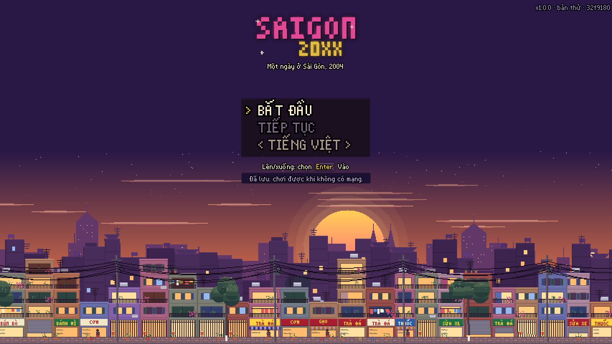<br><sub>The menu: BẮT ĐẦU starts the story, TIẾP TỤC picks up the last save</sub></td><td width="50%" align="center" valign="top">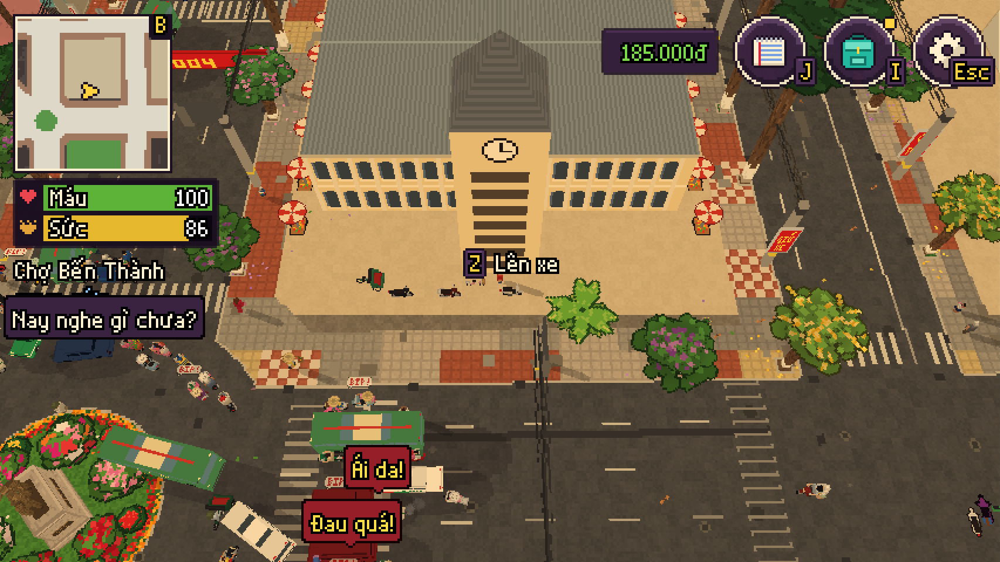<br><sub>On foot at the clock-tower gate of Chợ Bến Thành, with a [Z] prompt to hop on a bike</sub></td></tr>
  <tr><td width="50%" align="center" valign="top">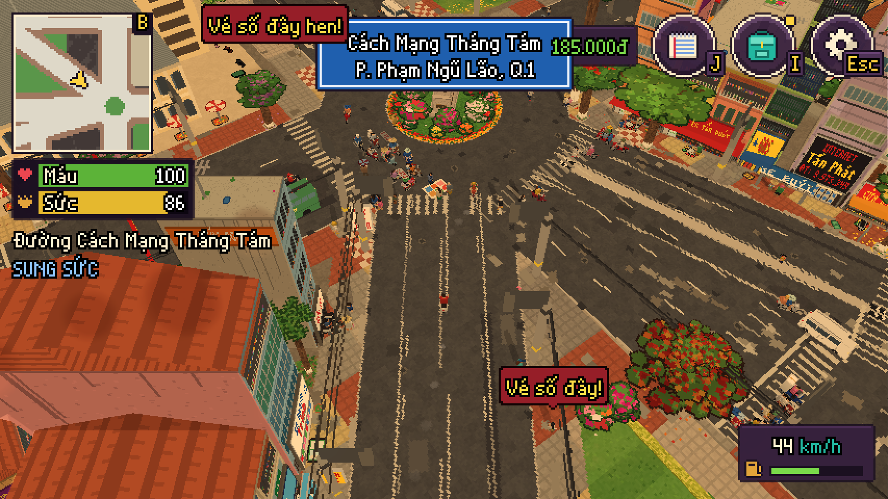<br><sub>Riding down Cách Mạng Tháng Tám into the Bến Thành roundabout</sub></td><td width="50%" align="center" valign="top">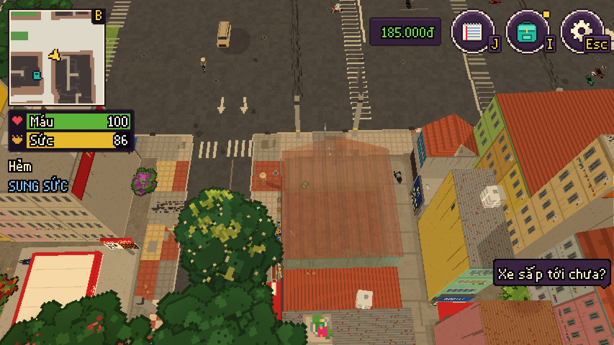<br><sub>Deep in a hẻm, between tube houses with rooftop gardens</sub></td></tr>
  <tr><td width="50%" align="center" valign="top">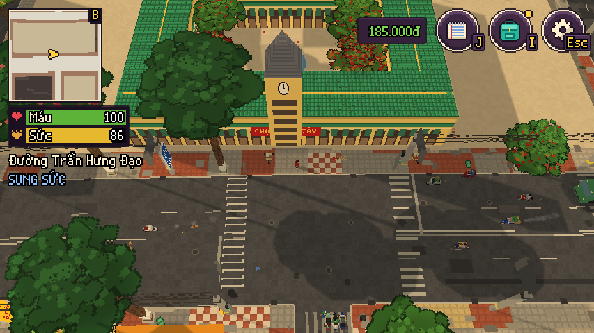<br><sub>Quận 5, Chợ Lớn: the clock tower of Chợ Bình Tây</sub></td><td width="50%" align="center" valign="top">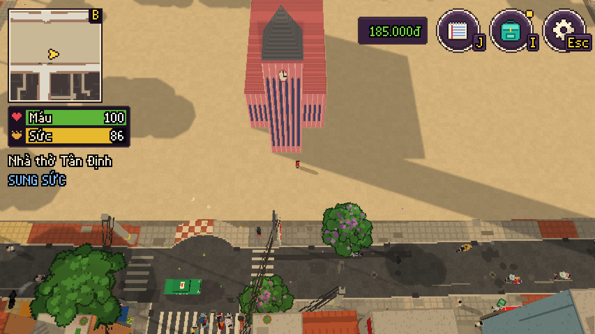<br><sub>Quận 3: the pink Tân Định church</sub></td></tr>
  <tr><td width="50%" align="center" valign="top">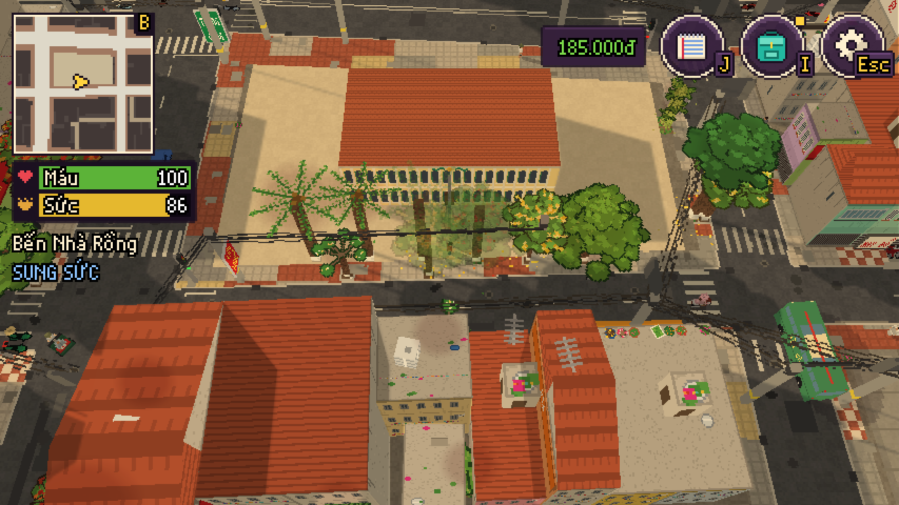<br><sub>Quận 4: Nhà Rồng wharf behind its palms</sub></td><td width="50%" align="center" valign="top">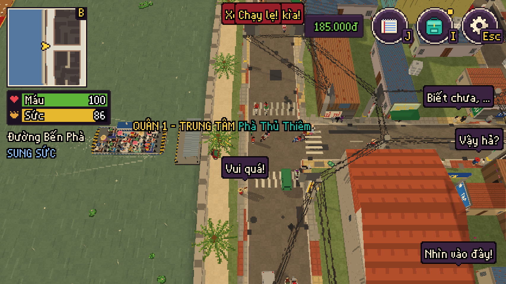<br><sub>Thủ Thiêm: the ferry landing, across the river from Quận 1</sub></td></tr>
  <tr><td width="50%" align="center" valign="top"><br><sub>After dark: lamps, lit shop fronts and headlights around Bến Thành</sub></td><td width="50%" align="center" valign="top">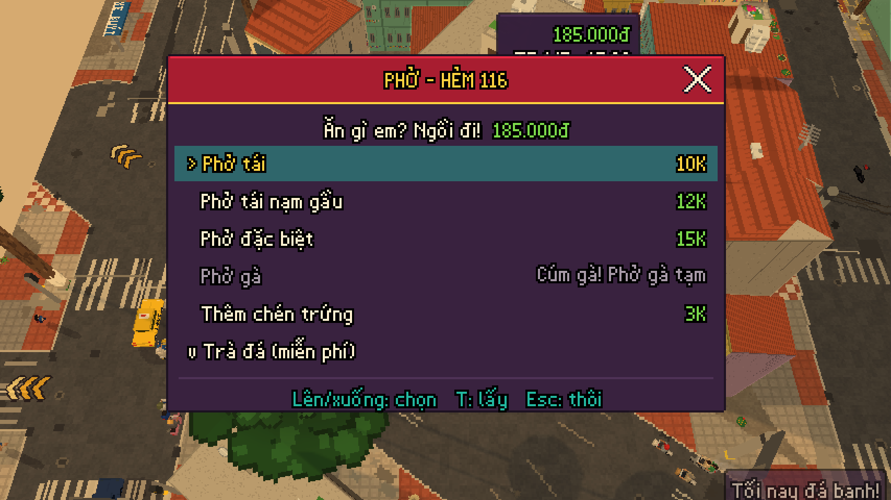<br><sub>Hungry? [T] at any shop door opens its menu: phở from 10k, at 2004 prices</sub></td></tr>
  <tr><td width="50%" align="center" valign="top">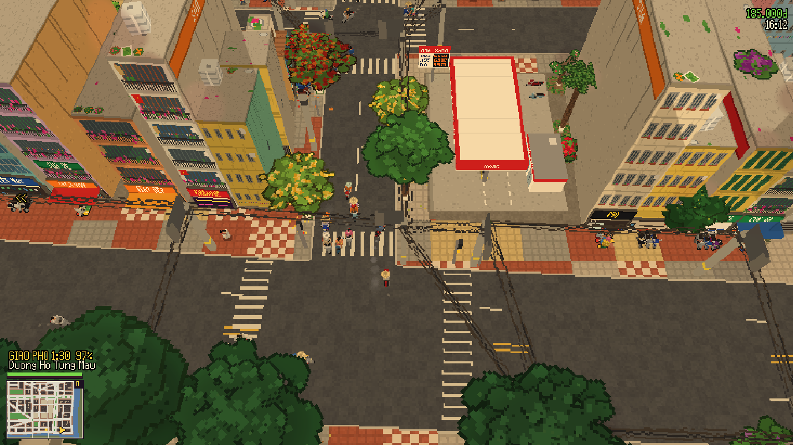<br><sub>Odd jobs: phở to a customer's door before it goes cold, with a beacon showing the way</sub></td><td width="50%" align="center" valign="top">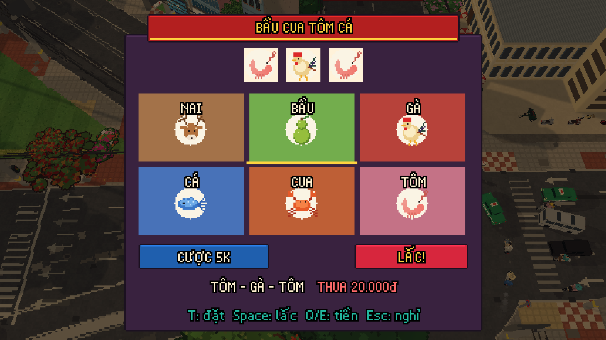<br><sub>Bầu cua cá cọp on a sidewalk mat: bet on the dice, shake, win or lose</sub></td></tr>
  <tr><td colspan="2" align="center">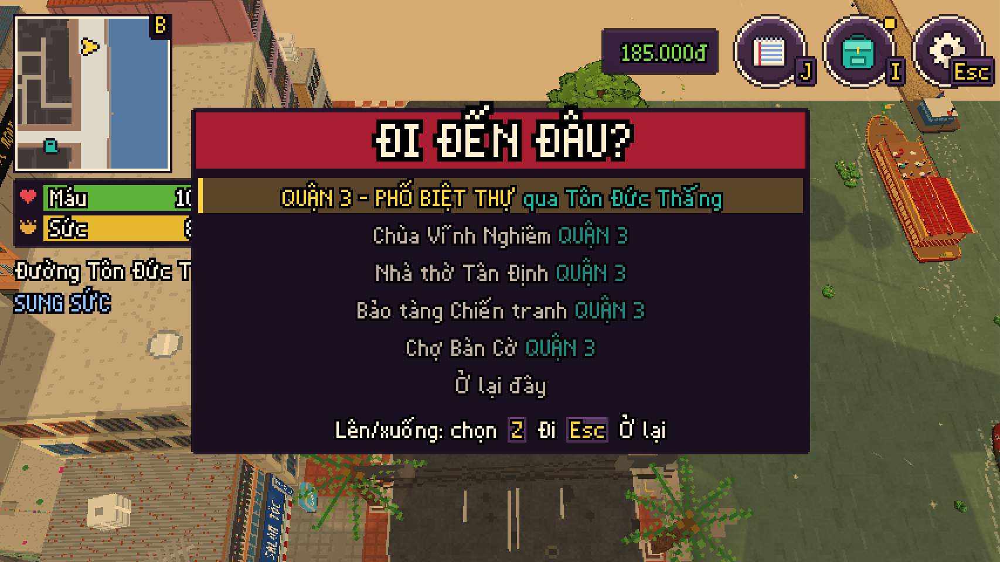<br><sub>At the edge of the map, ĐI ĐẾN ĐÂU? offers the next district and its landmarks</sub></td></tr>
  <tr><td width="50%" align="center" valign="top">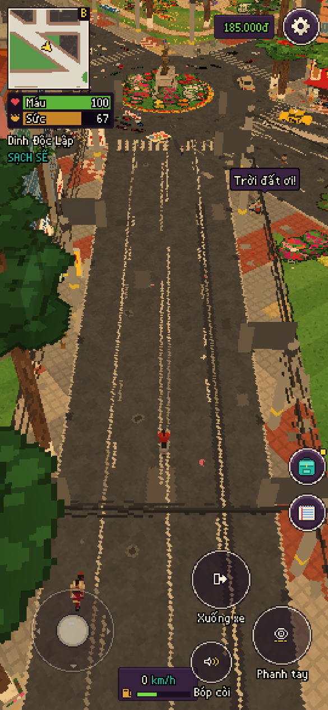<br><sub>On a phone, held upright: a thumb stick on the left, the buttons on the right</sub></td><td width="50%" align="center" valign="top">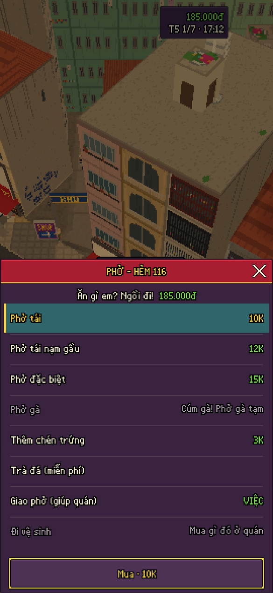<br><sub>A shop menu on a phone: up, down and OK under your right thumb</sub></td></tr>
</table>

## 👥 Meet the street

<p align="center"></p>

## 🏪 Every house is a business

<p align="center">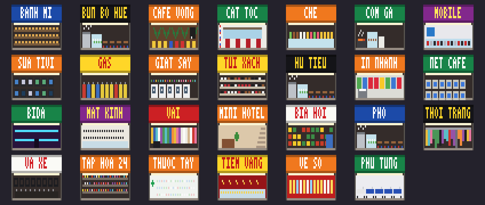</p>

## 📏 District 1, true scale

<p align="center">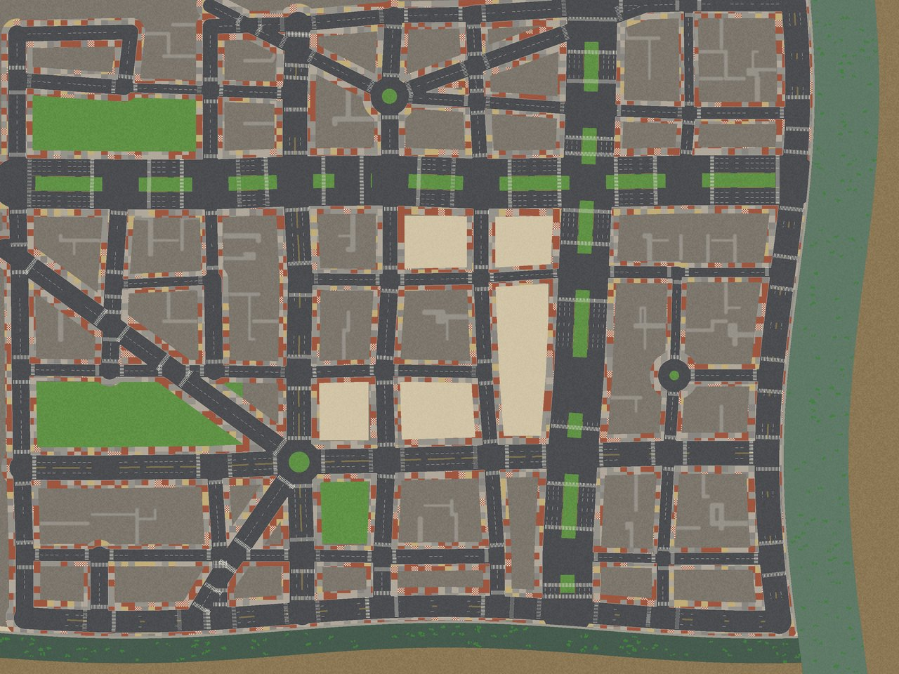</p>

## 🎮 Controls

| Keys | Action |
|---|---|
| <kbd>W</kbd><kbd>A</kbd><kbd>S</kbd><kbd>D</kbd> / arrows | Walk, ride, drive |
| <kbd>Shift</kbd> | Run (on foot) |
| <kbd>Space</kbd> | Handbrake, drift |
| <kbd>Z</kbd> / <kbd>E</kbd> / <kbd>Enter</kbd> | Get on / off, carjack |
| <kbd>T</kbd> | Talk, eat, shop, take a job, fill up at a pump |
| <kbd>J</kbd> | Notebook: goals, your job, your bike and room |
| <kbd>H</kbd> | Honk |
| <kbd>F</kbd> | Shove |
| <kbd>C</kbd> | Change clothes (on foot) |
| <kbd>V</kbd> | Camera: chase / north-up / top-down |
| <kbd>N</kbd> | Let time pass (to dusk, to night, to morning) |
| <kbd>R</kbd> | Restart the district |
| <kbd>Esc</kbd> / <kbd>P</kbd> | Pause and map; then <kbd>M</kbd> saves and goes back to the menu |

A gamepad works too. On a phone, hold it upright: a thumb stick on the left, and buttons on the right marked with
the same letters as the keys.

## ▶️ Play

**In the browser:** <https://zrg-team.github.io/Saigon20xx/play/>. Any modern browser works, on a desktop or on a phone held upright.

The build here is updated automatically every time the game changes.

**Offline:** download this repo and serve the `play/` folder with any static web server, for example:

```sh
npx http-server play -p 8080
```

Then open <http://localhost:8080>.

## 📦 What's in this repo

| Path | |
|---|---|
| `play/` | The playable web build |
| `site/` | The landing page at zrg-team.github.io/Saigon20xx |
| `media/` | Images for this README and the site |
| `.github/workflows/pages.yml` | Publishes `site/`, `media/` and `play/` to GitHub Pages on every push |

This repo only holds the game, and it is rewritten as one fresh commit on every update. The source code is
kept in a separate private repository.

## 📜 About

SaiGon 20XX is an original game, made with [Construct 3](https://www.construct.net) and TypeScript. All the art is
procedural pixel art generated for this game. It isn't affiliated with any other game, and no real brands appear
in the city.

<p align="center"><sub>Made with ☕ cà phê sữa đá.</sub></p>
